# SorakSora!: Real-Time Neobrutalist Cheer Wall and Audience Messaging Board

> A lightweight, real-time Neobrutalist cheer wall where spectators and communities can post words of encouragement, interact through a live spotlight wall, and optionally relay messages straight to a participant's mobile or smartwatch screen via Telegram.

---

## Overview and Core Philosophy

SorakSora! is a real-time Neobrutalist cheer wall and audience messaging board built around “The Cheer Wall”: spectator encouragement delivered live to stages, screens, phones, and wearable smartwatches. It validates incoming notes through a multi-tier safety engine and displays approved cheers on an interactive corkboard.

```mermaid
flowchart TD
    subgraph Audience["Audience & Supporters"]
        A1[Spectator Browser] -->|Submit Cheer Note| A2[Drop Cheer Modal]
        A1 -->|Tap Spammable Hearts| A3[Batched Likes Sync]
        A1 -->|Export Card 1:1, 9:16, 16:9| A4[Canvas Image Share]
    end

    subgraph AppServer["Next.js Application Core"]
        B1["/api/messages (POST)"]
        B2["/api/events (SSE Stream)"]
        B3["/r/:id (Direct Spotlight)"]
        B4["/api/cron/cheer-tick"]
    end

    subgraph SafetySuite["Content Moderation & Safety Engine"]
        C1["@sideid/id-profanity-filter (Dialects & Censor)"]
        C2["Custom Blacklist & Whitelist (28 Default Terms)"]
        C3["URL & Domain Spam Detection"]
        C4["Sliding-Window Rate Limiter"]
    end

    subgraph StorageLayer["Data Layer (PostgreSQL / SQLite)"]
        D1[("messages Table")]
        D2[("settings Table")]
    end

    subgraph ParticipantRelay["Live Participant Relay"]
        E1["Autonomous Periodic Shuffle Broadcaster"]
        E2["Instant Live Dispatcher"]
        E3["Telegram Bot HTTP API"]
        E4["Participant Wearables (Garmin, Apple Watch, COROS) & Phones"]
    end

    subgraph AdminConsole["Admin Operations (/admin)"]
        F1["Moderation Queue (Pending / Approved / Rejected)"]
        F2["Interactive Safety Sandbox"]
        F3["Live Configuration & Markdown Editor"]
        F4["CSV & JSON Data Backup"]
    end

    A2 --> B1
    A3 --> AppServer
    B1 --> SafetySuite
    SafetySuite -->|Clean / Flagged Result| StorageLayer
    StorageLayer -->|Approved Realtime Event| B2
    B2 -->|Live Card Injection| A1
    StorageLayer --> E1
    StorageLayer --> E2
    E1 --> E3
    E2 --> E3
    B4 --> E1
    E3 -->|Minimalist Notification Payload| E4
    AdminConsole -->|Review & Action| StorageLayer
    AdminConsole -->|Test Input| SafetySuite
```



### Versatile Platform Positioning
SorakSora! is intentionally designed for diverse live scenarios:
- **Endurance Sports and Athletic Races:** Marathons, cycling sportives, triathlons, and ultra trail runs where supporters want to send micro-cheers to participants mid-race.
- **Live Stages and Demo Days:** Hackathons, developer conferences, pitch competitions, and community showcases where audiences drop live reactions and questions.
- **Broadcasts and Watch Parties:** Esports tournaments, streaming events, and watch parties collecting live commentary and affirmations.
- **Personal Milestones and Fundraisers:** Charity runs, graduation challenges, and community campaigns celebrating individual achievements.

### Flexible Wearable and Mobile Relay Framing
When participants are on the move (such as running, riding, or presenting on stage), checking a website is impractical. SorakSora! features an optional Telegram bot bridge that relays approved cheer notes directly to a participant's wearable (Garmin, Apple Watch, COROS, WearOS) or smartphone lockscreen over Bluetooth.

### Design Aesthetic: High-Contrast Neobrutalism
The interface prioritizes clarity, physical paper texture, and bold visual contrast:
- **Hard Borders:** 2px and 3px solid black borders (`#000000`) define every container, input, button, and badge.
- **Offset Drop Shadows:** Sharp, unblurred drop shadows (`3px 3px 0px #000000` and `4px 4px 0px #000000`) replace soft diffuse blurs.
- **Curated Pastel Notes:** 11 distinct note backgrounds (Lemon, Mint, Sky Blue, Rose, Lavender, Peach, Aqua, Coral, Matcha, Sand, Chalk) paired with solid black text and headers.
- **Tactile Paper Simulation:** Subtle card tilts (`-2.5deg` to `+2.0deg`), decorative pin needles, washi tape corners, and gentle ambient wind sway.

---

## Feature Breakdown

### 1. Interactive Cheer Board
- **Real-Time Note Updates:** Approved notes stream live to active viewers via Server-Sent Events (`/api/events`) and Supabase WebSocket channels. New cards appear on the board with confetti effects without requiring manual refreshes.
- **Persistent Color Identity:** Spectators choose a sticky note color from 11 presets upon submission. The selected hue remains bound to the note across the wall, spotlight view, and social export cards.
- **Interactive Spotlight View:** Clicking any card opens an isolated spotlight modal with keyboard controls (`S` to shuffle to another random note, `Escape` to close). Visitors can tap spammable heart reactions that fire floating particles and sync to the server in debounced batches.
- **Canvas Social Share Export:** Client-side DOM rasterization via HTML5 Canvas (`html-to-image`) enables one-click image downloads in three standard formats:
  - `1:1` (Square Feed)
  - `9:16` (Story, Reels, Status)
  - `16:9` (Landscape Banner)
  Includes an optional camera shutter flash animation during capture.
- **Single-Line Submission Sanitization:** Form input handlers automatically normalize linebreaks (`\r\n`) and collapse consecutive whitespace into clean single-line strings.
- **Strict Non-Anonymous Validation:** When the anonymous toggle is turned off, the author input field is strictly required and rejects manual submissions of the word "Anonim". To submit anonymously, users must activate the dedicated toggle.

### 2. Clean URL Routing (`/r/:id`)
- **Direct Note Resolution:** Direct links matching `/r/:id` (using unique identifiers such as `su-xxxx` or UUIDs) query the database, load the underlying corkboard, and immediately open the target note inside the spotlight modal.
- **Transparent URL Masking:** On modal mount, the browser address bar cleanly rewrites to `/` via `window.history.replaceState({}, "", "/")`. Closing the modal leaves the visitor on the main board without triggering full-page navigation.
- **Shuffled Fallback Route (`/r`):** Navigating directly to `/r` automatically selects a random approved note and displays it in the spotlight modal, replacing the deprecated `/random` route.
- **Uniform Text Share Template:** Copying a note from the share menu produces structured, plain-text output formatted for messaging apps:
  ```text
  "{message}" — {author}

  via SorakSora • {site_url}/r/{unique_id}
  ```

### 3. Content Moderation and Safety Suite
Every incoming cheer note passes through a four-stage moderation pipeline before it can appear on the board:

1. **Profanity Filter (`@sideid/id-profanity-filter`):**
   - Four sensitivity thresholds: `strict`, `moderate`, `light`, and `childSafe`.
   - Built-in regional slang coverage across 8 Indonesian dialects: Javanese, Sundanese, Betawi, Batak, Minang, Balinese, Madurese, and Acehnese.
   - Detects leetspeak character substitutions and spaced-out word evasion techniques.
   - 4 censor rendering styles:
     - `Normal` (standard masking)
     - `Huruf Depan & Belakang` (retains first and last characters: `a***g`)
     - `Bintang` (full asterisk replacement: `*****`)
     - `Grawlix` (comic typography: `@#$%!`)
2. **Curated Blacklist and Whitelist Managers:**
   - Ships with 28 default non-political safety terms targeting predatory gambling, phishing links, counterfeit giveaways, and spam traps.
   - Whitelist manager allows event organizers to exempt team names, runner nicknames, or event jargon from false flags.
   - Compact tag chip interface with `.txt` file import and export capabilities.
3. **Abuse and Link Prevention:**
   - Regex domain scanner detects bare URLs and redirection services (`.com`, `.xyz`, `wa.me/`, `bit.ly/`, `t.me/`).
   - Standalone Sliding-Window Rate Limiter tracks visitor identifiers (client IP or visitor UUID) to prevent flood submissions (default: 3 submissions per 5-minute window).
   - Rate-limited users receive clear inline wait notices (`Coba lagi dalam 2 menit`).
4. **In-Admin Test Sandbox:**
   - Real-time diagnostic playground located in `/admin`.
   - Evaluates test sentences and outputs severity ratings (0.0 to 1.0), matched category tags, detected keywords, and censor output previews before saving policy changes.

### 4. Live Participant Bridge (Telegram / Wearable Push)
- **Instant Live Push:** When enabled, newly approved cheer notes are pushed immediately to a configured Telegram chat or channel.
- **Autonomous Periodic Shuffle Broadcaster:**
  - A scheduled background task triggered via `/api/cron/cheer-tick` that broadcasts cheer notes at regular intervals (e.g., every 5, 10, or 15 minutes).
  - Uses an engagement-weighted tier system to prioritize community favorites:
    - **Tier 1 (High Engagement):** Notes with 50+ likes.
    - **Tier 2 (Moderate Engagement):** Notes with 10 to 49 likes.
    - **Tier 3 (Base Engagement):** Notes with under 10 likes.
  - Notes within each tier are shuffled using the Fisher-Yates algorithm.
  - Cycle state persists in the database (`telegram_cycle_queue`, `telegram_cycle_dispatched`, `telegram_cycle_number`) to prevent duplicate dispatches within the same cycle.
  - **Live Arrival Reset:** When a new live cheer arrives and is approved, the broadcaster resets its cooldown timer and sends the live cheer immediately.
- **Minimalist Wearable Payload:** Payload text is formatted specifically for small wearable displays (COROS, Garmin, Apple Watch, WearOS), stripping markdown, hashtags, and links:
  ```text
  "Ayo gas terus! KM 30 di depan mata!" - Budi
  ```

### 5. Admin Dashboard (`/admin`)
- **Protected Access:** Secured via master `ADMIN_SECRET` key with optional 30-day "Remember Me" persistent cookie sessions.
- **Centralized Moderation Queue:** Separate tabs for *Pending*, *Approved*, *Rejected*, and *All* messages.
- **Batch Actions:** Single-click operations to "Approve All Pending", "Approve Selected", "Reject Selected", or "Delete Selected".
- **Inline Editing:** Update note text, sender name, anonymous toggle, sticky note color, and like counters directly from the admin card.
- **Inline Markdown Support:** Edit campaign descriptions and top announcement banners with full Markdown formatting and live preview.
- **Debounced Auto-Save:** Setting adjustments (rate limits, filters, Telegram configs) save automatically with visual feedback.
- **Archive Mode:** A persistent, auto-saved admin toggle closes new submissions while preserving the public wall, spotlight, reactions, direct links, and share exports. The public API enforces the lock with HTTP `403`.
- **Data Export:** Complete database backup exports in CSV (RFC 4180 standard) and JSON formats.

---

## Tech Stack

| Layer | Technology | Function |
|---|---|---|
| **Framework** | Next.js 16 (App Router) | Server components, route handlers, Turbopack |
| **Language** | TypeScript 5 | End-to-end static typing across schemas and APIs |
| **Styling** | Tailwind CSS v4 | Neobrutalist styling with 2px borders and hard drop shadows |
| **Primary Database** | Supabase (PostgreSQL) | Production database with Row-Level Security and Realtime |
| **Local Database Engine** | Node.js `node:sqlite` | Built-in SQLite with Write-Ahead Logging for rapid local dev |
| **Iconography** | Lucide React | Clean, scalable SVG icons |
| **Micro-Interactions** | `canvas-confetti` | Particle animations on approval and love reactions |
| **Canvas Export** | `html-to-image` | Client-side DOM rasterization to PNG images |
| **Content Moderation** | `@sideid/id-profanity-filter` | Dialect analysis, leetspeak detection, censor styling |
| **Hardware / Mobile Relay** | Telegram Bot API | Direct HTTP API integration (`/sendMessage`) with 5000ms timeout guard |
| **Testing** | Playwright Test | End-to-end automated test suite |

---

## Environment Variables and Quick Start

### Environment Variables Reference

Create a `.env.local` file in the project root:

```env
# ------------------------------------------------------------------------------
# SorakSora! Environment Variables Configuration
# ------------------------------------------------------------------------------

# Server Listening Port (optional, default: 3000)
PORT=3000

# Admin Master Password for /admin access
ADMIN_SECRET=replace-with-a-strong-admin-secret
ADMIN_SECRET_KEY=replace-with-a-strong-admin-secret

# Canonical and Public Site URL
NEXT_PUBLIC_SITE_URL=https://soraksora.kuma.id
SITE_URL=https://soraksora.kuma.id

# Supabase Cloud Database and Realtime (PostgreSQL backend)
NEXT_PUBLIC_SUPABASE_URL=https://your-project.supabase.co
NEXT_PUBLIC_SUPABASE_ANON_KEY=your-supabase-anon-key
SUPABASE_SERVICE_ROLE_KEY=your-supabase-service-role-key

# Telegram Wearable and Mobile Relay (Optional default fallback credentials)
TELEGRAM_BOT_TOKEN=123456789:ABCDefghIJKlmNoPQRsTUVwxyZ
TELEGRAM_CHAT_ID=-1001234567890

# Optional Secret Token for /api/cron/cheer-tick endpoint protection
CRON_SECRET=your-secure-cron-secret-token

# Site Metadata and Open Graph Branding
NEXT_PUBLIC_SITE_TITLE="SorakSora! — The Cheer Wall"
NEXT_PUBLIC_SITE_DESCRIPTION="SorakSora — The Cheer Wall: papan sorak Neobrutalist real-time yang mengantarkan dukungan penonton langsung ke panggung, layar, dan smartwatch."
NEXT_PUBLIC_OG_IMAGE_URL=https://soraksora.kuma.id/og-image.png
```

### Installation and Quick Start

1. **Clone and Install:**
   ```bash
   git clone https://github.com/munukhu/SorakSora.git
   cd SorakSora
   npm install
   ```

2. **Configure Environment:**
   ```bash
   cp .env.example .env.local
   ```

3. **Start Development Server:**
   ```bash
   npm run dev
   ```
   Open **[http://localhost:3000](http://localhost:3000)** in your browser.

4. **Build and Run Production:**
   ```bash
   npm run build
   npm run start
   ```

5. **Run End-to-End Tests:**
   ```bash
   npm run test:e2e
   ```

6. **Local Network Testing (Mobile):**
   ```bash
   npx next dev -H 0.0.0.0
   ```
   Access `http://<your-ip>:3000` from any device connected to the same local network.

---

## Database Schema Reference

SorakSora! uses two primary tables. When configured with Supabase PostgreSQL, tables use Row-Level Security. When running the local SQLite engine, the database automatically initializes at `./data/showup.db` with Write-Ahead Logging (`PRAGMA journal_mode = WAL;`). The legacy filename remains unchanged to preserve existing local data.

### 1. `messages` Table

Stores visitor cheer submissions, moderation outcomes, and love reaction metrics.

| Column | Type (PostgreSQL / SQLite) | Constraints | Description |
|---|---|---|---|
| `id` | `TEXT` / `UUID` | `PRIMARY KEY` | Unique record identifier (UUID v4) |
| `unique_id` | `TEXT` | `UNIQUE` | Compact public link identifier (`su-xxxx`), indexed |
| `name` | `TEXT` | `NOT NULL DEFAULT 'Anonim'` | Author or spectator display name |
| `is_anonymous` | `BOOLEAN` / `INTEGER` | `NOT NULL DEFAULT 0` | Flag masking author name to "Anonim" |
| `message` | `TEXT` | `NOT NULL` | Cheer message content (sanitized, single line) |
| `color` | `TEXT` | `NOT NULL DEFAULT ''` | Note background hex color from 11 presets |
| `likes` | `INTEGER` | `NOT NULL DEFAULT 0` | Heart reaction counter |
| `status` | `TEXT` | `NOT NULL DEFAULT 'pending'` | Moderation state: `approved`, `pending`, `rejected` |
| `is_pinned` | `BOOLEAN` / `INTEGER` | `NOT NULL DEFAULT 0` | Flag to pin note to top of archive |
| `is_flagged` | `BOOLEAN` / `INTEGER` | `NOT NULL DEFAULT 0` | Automated moderation flag |
| `flagged_reason` | `TEXT` | `NOT NULL DEFAULT ''` | Filter layer triggering the flag |
| `severity_score` | `REAL` / `FLOAT` | `NOT NULL DEFAULT 0.0` | Numerical toxicity score (0.0 to 1.0) |
| `flagged_categories` | `TEXT` | `NOT NULL DEFAULT ''` | Matched safety category tokens |
| `matched_words` | `TEXT` | `NOT NULL DEFAULT ''` | Exact banned terms caught |
| `created_at` | `TEXT` / `TIMESTAMPTZ` | `NOT NULL` | ISO 8601 creation timestamp |

#### PostgreSQL Table Definition (Supabase)
```sql
CREATE TABLE IF NOT EXISTS public.messages (
    id UUID PRIMARY KEY DEFAULT gen_random_uuid(),
    unique_id TEXT UNIQUE,
    name TEXT NOT NULL DEFAULT 'Anonim',
    is_anonymous BOOLEAN NOT NULL DEFAULT FALSE,
    message TEXT NOT NULL,
    color TEXT NOT NULL DEFAULT '#FEF08A',
    likes INTEGER NOT NULL DEFAULT 0,
    status TEXT NOT NULL DEFAULT 'pending' CHECK (status IN ('pending', 'approved', 'rejected')),
    is_pinned BOOLEAN NOT NULL DEFAULT FALSE,
    is_flagged BOOLEAN NOT NULL DEFAULT FALSE,
    flagged_reason TEXT NOT NULL DEFAULT '',
    severity_score REAL NOT NULL DEFAULT 0,
    flagged_categories TEXT NOT NULL DEFAULT '',
    matched_words TEXT NOT NULL DEFAULT '',
    created_at TIMESTAMPTZ NOT NULL DEFAULT NOW()
);

CREATE UNIQUE INDEX IF NOT EXISTS idx_messages_unique_id ON public.messages (unique_id);
CREATE INDEX IF NOT EXISTS idx_messages_status ON public.messages (status);
CREATE INDEX IF NOT EXISTS idx_messages_likes ON public.messages (likes DESC);
```

### 2. `settings` Table

Key-value store maintaining operational flags, filter thresholds, and Telegram relay state.

| Column | Type | Constraints | Description |
|---|---|---|---|
| `key` | `TEXT` | `PRIMARY KEY` | Configuration key name |
| `value` | `TEXT` | `NOT NULL` | Stored value or JSON string |

#### Core Setting Keys
- `auto_accept`: Automatically approve clean submissions (`true` / `false`).
- `about_description`: Event and campaign description in Markdown format.
- `announcement_enabled` & `announcement_text`: Global top banner controls with inline Markdown support.
- `is_archived`: Closes new submissions while keeping existing messages, reactions, spotlight, and sharing available (`false` by default).
- `archive_announcement`: Markdown-enabled public archive notice shown while Archive Mode is active; supports headings, links, bold (`**text**` / `__text__`), italics, and lists.
- `max_char_limit`: Maximum permitted cheer message character length (default: `280`).
- `enable_content_moderation`: Master switch for the moderation engine.
- `enable_builtin_filter`, `enable_custom_filter`, `enable_url_filter`: Individual filter layer toggles.
- `banned_words` & `whitelist_words`: Comma-separated dictionary token strings.
- `filter_preset`: Sensitivity preset (`strict`, `moderate`, `light`, `childSafe`).
- `filter_censor_mode`: Censor display style (`normal`, `first_last`, `asterisk`, `grawlix`).
- `rate_limit_enabled`, `rate_limit_max_submissions`, `rate_limit_window_minutes`: Submission throttling parameters.
- `telegram_bot_token` & `telegram_chat_id`: Telegram relay credentials.
- `telegram_instant_enabled`: Relay newly approved cheers immediately.
- `telegram_periodic_enabled` & `telegram_interval_minutes`: Periodic shuffle relay schedule.
- `telegram_cycle_queue`: JSON array of unplayed message IDs for the active broadcast cycle.
- `telegram_cycle_dispatched`: JSON array of message IDs already dispatched in the active cycle.
- `telegram_cycle_number`: Integer counter tracking the current broadcast iteration.

---

## API Reference

### Public Endpoints

| Method | Endpoint | Description |
|---|---|---|
| `GET` | `/api/messages` | Retrieves list of approved cheer notes for the public board |
| `POST` | `/api/messages` | Submits a new cheer note; processes through safety pipeline |
| `POST` | `/api/messages/:id/like` | Records spammable heart reactions (supports batched increment) |
| `GET` | `/api/events` | Server-Sent Events (SSE) stream for live approvals and like updates |
| `GET` | `/r/:id` | Direct link route resolving a unique cheer note into the spotlight |

### Admin Endpoints (Requires `Authorization: Bearer <ADMIN_SECRET>`)

| Method | Endpoint | Description |
|---|---|---|
| `POST` | `/api/admin/auth` | Authenticates admin passcode; establishes secure session cookie |
| `GET` | `/api/admin/messages` | Fetches notes across all moderation statuses with filter options |
| `PATCH` | `/api/admin/messages` | Updates note status (approve/reject/edit) or adjusts like counts |
| `DELETE` | `/api/admin/messages` | Deletes notes permanently |
| `GET` | `/api/admin/settings` | Returns active application settings |
| `PATCH` | `/api/admin/settings` | Updates application settings, safety dials, and Telegram configs |
| `GET` | `/api/admin/export?format=csv` | Exports full message database as RFC 4180 CSV |
| `GET` | `/api/admin/export?format=json` | Exports full message database as JSON |
| `POST` | `/api/admin/telegram/test` | Dispatches a test message to the configured Telegram bot |

### Automation and Cron Endpoints

| Method | Endpoint | Auth | Description |
|---|---|---|---|
| `GET` / `POST` | `/api/cron/cheer-tick` | `Bearer <CRON_SECRET>` or `ADMIN_SECRET` | Evaluates the periodic shuffle queue and dispatches the next note |

---

## License

This project is licensed under the [MIT License](LICENSE).
